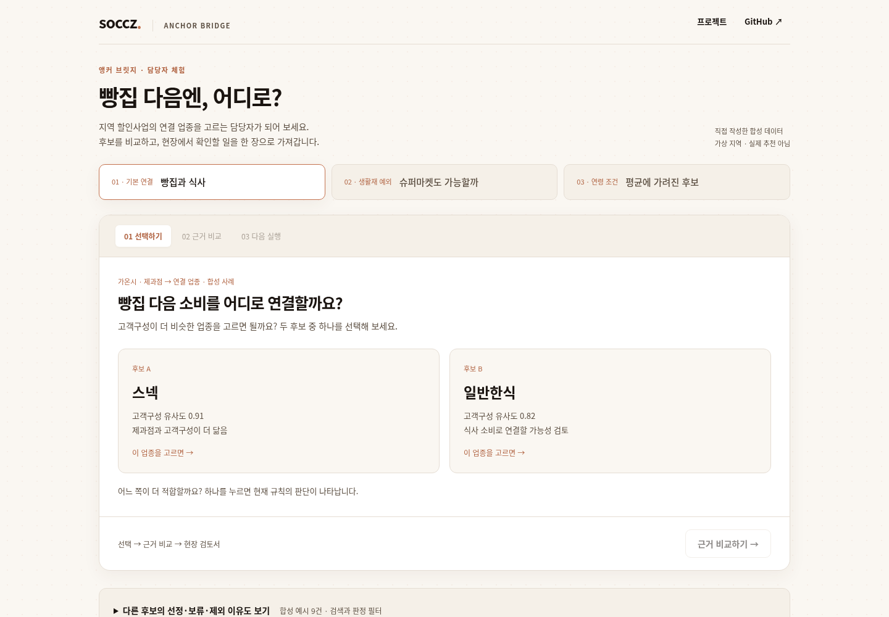

# 앵커 브릿지 · Anchor Bridge

**빵집 다음엔, 어디로?** 지역 할인사업에서 연결할 업종을 고르고, 선정·제외 이유와 현장 확인 사항을 함께 남기는 서비스 제안입니다.

[프로젝트 소개](https://soccz.github.io/projects/anchor-bridge/) · [후보 비교 체험](https://soccz.github.io/projects/anchor-bridge/demo/) · [4쪽 소개서](site/documents/AnchorBridge_Public_Brief.pdf) · [10쪽 설계서](site/documents/AnchorBridge_Public_Methods.pdf)



협심대의 BC카드 「제1회 AI금융빅데이터플랫폼 소비데이터 활용 분석·아이디어 공모전」 제안입니다. 원본 제출물은 **요약서 4쪽·보고서 81쪽·단일 HTML MVP**입니다. 이 저장소는 그 판단 과정과 서비스 경험을 독립 합성 예제로 공개합니다.

## 직접 해보기

`site/demo/index.html`을 다운로드해 브라우저로 열면 됩니다. 설치·로그인·서버·별도 데이터 파일·인터넷이 필요하지 않습니다.

1. **빵집과 식사:** 스넥과 일반한식 중 하나를 고릅니다. 고객구성만 보고 고른 후보가 선별 규칙에서도 남는지 확인합니다.
2. **근거 비교:** 분모를 전체 소비에서 제과점 제외로 바꿉니다. 일반한식의 LQ 0.88이 CLQ 1.32가 되는 계산을 비중 막대와 함께 봅니다.
3. **다음 실행:** 현장 확인 항목을 표시하고 메모를 작성합니다. 검토서 미리보기에서 인쇄하거나 PDF로 저장합니다.

생활재와 연령 사례에서는 다른 판단을 체험합니다. 전체 후보 9건은 별도로 펼쳐 검색·필터링할 수 있습니다. 메모와 체크 상태는 열린 화면에만 보관되며 새로고침하면 사라집니다. 프로젝트·PDF·GitHub 링크를 여는 경우에는 인터넷이 필요합니다.

## 세 사례가 설명하는 것

| 사례 | 바꾸는 기준 | 남기는 판단 |
|---|---|---|
| 가온시 · 제과점 | 전체 소비 → 지역·비교 모집단에서 앵커 제외 | 일반한식의 소비기반 재검토. 스넥은 시연의 역행 가정으로 탐색적 제외 |
| 누리군 · 슈퍼마켓 | 생활재 일괄 제외 → 별도 검토 | 범위만 넓히고 후속 조건은 유지. 건수 자격이 부족한 파트너는 제외 |
| 다온시 · 제과점 | 전 연령 → 특정 연령 | 자격을 얻어도 공급·거리는 미확인. 기본 파트너와 분리한 추가 확인 |

지명·수치·판정은 **모두 직접 작성한 합성 예시**입니다. 실제 공모전 자료를 추출·익명화·교란한 값이 아닙니다. 고객구성 유사도는 설정값이며, 월별 선은 합성 계열의 움직임입니다. 역행 제외는 설명을 위한 입력 가정으로, 실제 유의성 검정을 통과했다는 뜻이 아닙니다.

## 분석에서 중요했던 설계 선택

**비교의 분모를 양쪽에서 맞춥니다.** 지역에서만 큰 업종을 제거하면 비교 모집단과 기준이 달라집니다. 금액·건수에 같은 정의를 적용하고, 정의할 수 없는 값은 임의의 큰 점수로 채우지 않습니다.

**연령 효과와 관측대상 변경을 구분합니다.** 전체 집계에서 연령 미상 결제를 제외하는 것만으로 자격이 바뀔 수 있습니다. 전체 → 연령 확인 집단 → 특정 연령 순서로 비교하는 예제를 제공합니다.

**점포 매핑의 불확실성을 남깁니다.** 공공 분류가 두 음식 업종을 묶으면 합계 점포 수를 한 업종의 공급으로 쓰지 않습니다. 공급 미확인과 거리 미달은 다른 상태입니다.

**지역 분할과 시간 검증은 다른 조건입니다.** 지역을 나누어도 미래의 학습 정답을 사용하면 전향 예측 검증이 아닙니다. 특징과 학습 정답의 이용 가능일을 함께 점검하는 예제를 제공합니다. 이 검사가 모든 누수를 자동으로 탐지하지는 않습니다.

**선정과 효과를 구분합니다.** 한 달에 의존하는 관계의 반례를 실행할 수 있습니다. 후보를 남겼다는 것만으로 실제 교차구매나 할인 효과가 확인된 것은 아닙니다. 효과는 일반할인과 연결할인의 무작위 비교 제안으로 분리합니다.

## 문서에서 더 읽기

| 문서 | 내용 |
|---|---|
| [공개 소개서 · 4쪽](site/documents/AnchorBridge_Public_Brief.pdf) | 대표 후보 비교, 세 관점, 현장 검토서·사업화, 비교 실험 |
| [분석·서비스 설계서 · 10쪽](site/documents/AnchorBridge_Public_Methods.pdf) | 입력·분모, 선정·보류, 구성 효과, 관계·누수 검증, 검토서, 사업·실증 설계 |

두 문서는 공개용 재편집본입니다. 원본 제출 PDF나 실제 지역 결과표를 일부 가려서 공개한 문서가 아닙니다. 원본 결과·이미지·메타데이터를 옮기지 않고 새 소스에서 생성합니다.

## 계산 예제 실행

Python 3.10 이상. 계산과 테스트는 표준 라이브러리를 사용합니다.

```bash
python -m analysis.synthetic
python -m unittest discover -s tests -v
python scripts/build.py
```

로컬 웹으로 보려면 다음 명령을 사용합니다. 단일 파일 시연은 `site/demo/index.html`을 직접 열어도 됩니다.

```bash
python -m http.server 8000 --directory site
```

| 모듈 | 공개한 구현 |
|---|---|
| `analysis/metrics.py` | LQ·CLQ, 공통 연령 가중치, 축약 후보 판정 |
| `analysis/diagnostics.py` | 상관·한 달 제외, 관측대상 변경 구분, 이용 가능 시점 검사 |
| `analysis/synthetic.py` | 9개 후보, 독립 합성 집계·월별 계열·구성 비교 |
| `web/` | 메인 포트폴리오와 같은 시각 체계의 소개 페이지, 3단계 시연 |
| `documents/` | 화면 축소 캡처 대신 계산·비교·검토서 내용을 담은 인쇄 소스 |
| `scripts/` | 빌드, Chrome 시연 검증, PDF 지면·본문·링크 검사 |

## 검증과 재생성

공개 PDF 재생성에는 WeasyPrint와 Noto Sans CJK KR 글꼴이 필요합니다. 브라우저 검증은 Chrome/Chromium, `websocket-client`, `PyMuPDF`를 사용합니다. 문서 검사는 `qpdf`를 사용합니다.

```bash
python scripts/check_browser.py
python scripts/build.py --pdf
python scripts/check_publication.py
```

계산 테스트는 한쪽 분모만 제거하는 오류, 잘못된 입력, 결측 연령층, 한 관측에 의존하는 상관, 집단 변경을 연령 효과로 오인하는 경우, 미래의 학습 정답을 사용한 경우를 확인합니다.

Chrome 검증은 세 사례의 선택·기준 전환, 메모의 안전한 출력, 검토서 9종의 한 쪽 인쇄, 최대 길이 메모, 검색·필터·빈 결과, 키보드 포커스, 모바일의 선택·상세 위치, 독립 오프라인 실행을 확인합니다. 기능 검증과 별도로 데스크톱·모바일 및 PDF 전 페이지를 렌더링해 읽습니다.

## 공개 범위

공모전 원자료·실제 지역별 수치와 원장·회귀 기준값·원본 제출 PDF는 포함하지 않습니다. [공모전 공식 안내](https://abp.bccard.com/dataContest/dataContestDetailPage?contestNo=9000001)는 제공 데이터의 제3자 제공·재배포를 제한합니다.

이 코드는 핵심 계산과 검증을 실행하는 예제이며 비공개 전체 분석의 재현 패키지는 아닙니다. 혜택 발행·회원 배정·실제 효과측정은 구현하지 않았습니다. 수상·도입·매출 증가 실적을 주장하지 않습니다. 별도 재사용 라이선스를 부여하지 않았으며, 코드·문서 권리와 공모전 데이터의 이용 조건은 별개입니다.
